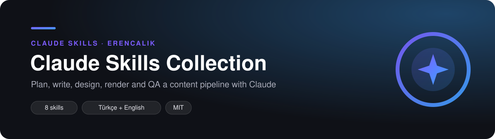
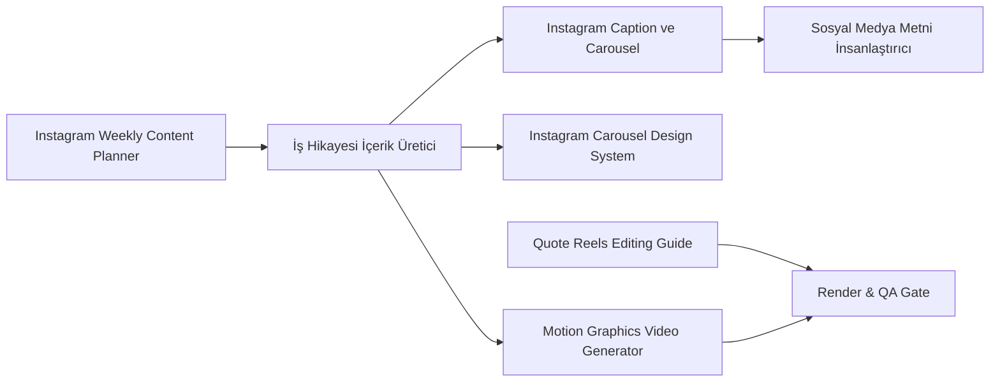

<p align="center"></p>

<p align="center">
  
  
  
  
</p>

<p align="center"><b>Claude skills for running a content operation end to end: research, planning, writing, design, video rendering and QA.</b><br>
Each skill lives in its own repo and installs with one command.</p>

---

## 🗺️ How they fit together



## 🧰 Skills

### 📈 Instagram growth

| Skill | What it does | Lang |
|---|---|:---:|
| **[Instagram Weekly Content Planner](https://github.com/erencalik/instagram-weekly-content-planner-claude)** | Weekly plan, niche research and post audits, ranked by evidence |  |
| **[Instagram Caption ve Carousel](https://github.com/erencalik/instagram-aciklama-carousel-metni-claude)** | Caption, hashtag, alt metin ve carousel metni, kontrol makbuzuyla |  |
| **[Sosyal Medya Metni İnsanlaştırıcı](https://github.com/erencalik/sosyal-medya-metni-insanlastirma-claude)** | Türkçe metinden yapay zeka izlerini temizler, beş kontrolle puanlar |  |

### 🎨 Content production

| Skill | What it does | Lang |
|---|---|:---:|
| **[İş Hikayesi İçerik Üretici](https://github.com/erencalik/is-hikayesi-icerik-uretici-claude)** | Şirket ve kurucu hikayelerinden doğrulanmış carousel ve Reels |  |
| **[Instagram Carousel Design System](https://github.com/erencalik/instagram-carousel-design-system-claude)** | From a brand interview to pixel-checked 1080×1350 PNG slides |  |
| **[Motion Graphics Video Generator](https://github.com/erencalik/motion-graphics-video-generator-claude)** | One request to a scored MP4: HTML, headless Chromium, ffmpeg |  |

### 🎬 Video operations

| Skill | What it does | Lang |
|---|---|:---:|
| **[Quote Reels Editing Guide](https://github.com/erencalik/quote-reels-editing-guide-claude)** | One-page editing spec for a daily quote Reels series |  |
| **[Render & QA Gate](https://github.com/erencalik/video-render-qa-gate-claude)** | Hang-proof rendering and a pre-delivery quality gate |  |

Skills that work on Turkish text and Turkish sources are written in Turkish; everything else is in English.

## ⚙️ Install

```bash
git clone https://github.com/erencalik/<repo>.git ~/.claude/skills/<repo-without-claude-suffix>
```

On claude.ai, download a repo as a ZIP (Code → Download ZIP) and upload it under Settings → Capabilities → Skills.

## 🧭 Design principles

- **Writes and reads, never publishes.** No skill posts or schedules anything without the user's approval.
- **No invented numbers.** Unknown values stay marked as `{{number}}`.
- **Checks itself before showing.** Renders, scores and check receipts are reviewed before they reach the user.
- **Credits its sources.** Adapted methods name their original authors.

## 🇹🇷 Türkçe özet

Bir içerik operasyonunu (araştırma, planlama, metin, tasarım, video render, kalite kontrol) uçtan uca yürütmek için geliştirdiğim Claude skill'leri. Türkçe metin ve Türk kaynaklarıyla çalışan skill'ler Türkçe, diğerleri İngilizce yazıldı. Her biri kendi reposunda ve tek komutla kurulur.

## 📄 License

Every repo is MIT licensed.
